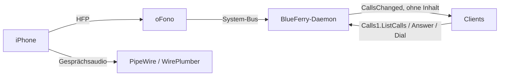

# Anrufe (optional)

BlueFerry kann eingehende iPhone-Anrufe anzeigen und über die
Freisprech-Unterstützung (HFP) von
[oFono](https://git.kernel.org/pub/scm/network/ofono/ofono.git) Anrufe
annehmen, ablehnen, starten und beenden. Die Funktion ist **standardmäßig
aus** und für Nachrichten nicht nötig. Ist sie aus, spricht BlueFerry gar
nicht mit oFono und verhält sich genau wie bisher.

Ein früherer HFP-Versuch wurde aus BlueFerry entfernt, weil oFono und das
eingebaute HFP-Backend von PipeWire um dasselbe Bluetooth-Profil
konkurrieren. Diese Integration überlässt dir diese Einrichtung, schlägt
oFono nur als optionales Paket vor und lässt den Daemon normal weiterlaufen,
wenn oFono fehlt.

## Was es tut



- Findet das oFono-Modem des iPhones, schaltet es ein, solange die
  Bluetooth-Classic-Verbindung steht, und bringt es online (iOS macht das
  nicht von selbst).
- Zeigt bei einem eingehenden Anruf eine Desktop-Mitteilung mit **Answer**
  und **Decline**. Sie schließt sich, sobald es nicht mehr klingelt.
- Der Qt-Client bekommt einen Dialog **Phone Calls**, der Terminal-Client
  ein Anruf-Panel (`c`) und die CLI die Befehlsgruppe `calls`:

  ```bash
  blueferry calls                 # Zustand und laufende Anrufe
  blueferry calls enable          # oder: disable
  blueferry calls dial '+41 79 123 45 67'   # fragt nach; --yes in Skripten
  blueferry calls answer
  blueferry calls dtmf 1234#      # Töne im aktiven Anruf
  blueferry calls hangup          # oder: hangup --all
  ```

- Stellt die Anruflautstärke von oFono auf 100 %, weil die
  Standardeinstellung von 50 % mit einem iPhone kaum hörbar ist.

Das Audio selbst leitet PipeWire. Standardmässig nutzt der Anruf den
Lautsprecher und das Mikrofon des Systems; unter
[Lautsprecher und Mikrofon für Anrufe](#lautsprecher-und-mikrofon-fur-anrufe)
lassen sich eigene nur für Anrufe wählen.

## Einschalten

1. oFono (entwickelt mit 2.18) als Systemdienst installieren und starten.
   BlueFerry startet es nie selbst.
2. Deinem Benutzer den Zugriff auf oFono erlauben. Die mitgelieferte Policy
   lässt nur root und `at_console`-Sitzungen zu. Lege
   `/etc/dbus-1/system.d/ofono-local.conf` an:

   ```xml
   <!DOCTYPE busconfig PUBLIC "-//freedesktop//DTD D-BUS Bus Configuration 1.0//EN"
    "http://www.freedesktop.org/standards/dbus/1.0/busconfig.dtd">
   <busconfig>
     <policy user="dein-login">
       <allow send_destination="org.ofono"/>
     </policy>
   </busconfig>
   ```

   Damit kann jeder Prozess dieses Benutzers oFono vollständig steuern, nicht
   nur BlueFerry.
3. WirePlumber soll HFP an oFono übergeben, etwa in
   `~/.config/wireplumber/wireplumber.conf.d/51-bluez-ofono.conf`:

   ```text
   monitor.bluez.properties = {
     bluez5.hfphsp-backend = "ofono"
   }
   ```

   Setze dort keine `bluez5.roles`; BlueFerrys Telefon-Audio-Fragment behält
   die Freisprech-Rollen, solange Anrufe an sind.
4. Ab BlueZ 5.87 muss das eigene HFP-Plugin von BlueZ aus sein, damit es
   oFono den Kanal nicht wegnimmt. Die Pakete für Arch und Fedora starten
   `bluetoothd` bereits mit `-P hfp`; sonst ergänzt du `-P hfp` selbst. Fehlt
   das und scheitert die Freisprech-Verbindung dreimal in Folge, zeigt BlueFerry
   den Zustand `bluez_conflict` und versucht es nur noch alle fünf Minuten
   oder nach einer neuen Verbindung des Telefons.
5. In den iPhone-Einstellungen des Qt-, GTK- oder Quickshell-Clients
   **Enable phone calls through this computer** einschalten oder
   `blueferry calls enable` ausführen. Die
   Wahl wird gespeichert und gilt sofort. `BLUEFERRY_CALLS_ENABLED=true` in
   `~/.config/blueferry/local.env` funktioniert weiter als Anfangswert; eine
   gespeicherte Wahl hat Vorrang. Das Häkchen allein reicht nicht: oFono
   muss das Freisprech-Backend sein (Schritt 3) und das eigene HFP-Plugin
   von BlueZ abgeschaltet (Schritt 4). Läuft WirePlumber nicht als
   systemd-Benutzerdienst, starte es danach selbst neu, damit es die
   Freisprech-Rollen übernimmt.

Solange Anrufe an sind und das iPhone verbunden ist, bleibt seine
Freisprech-Verbindung zu diesem Computer bestehen: Anrufe klingeln hier und
laufen, wenn du sie hier annimmst, auch hier über Lautsprecher und Mikrofon.
Schaltest du Anrufe aus (oder beendest das Backend), gibt BlueFerry diese
Verbindung wieder frei, und das Gesprächsaudio geht zurück aufs Telefon.

`blueferry calls` sollte dann `ready` zeigen, solange das iPhone verbunden
ist.

## Lautsprecher und Mikrofon für Anrufe

BlueFerry kann Anrufe über einen anderen Lautsprecher abspielen und von einem
anderen Mikrofon aufnehmen als das System, zum Beispiel über ein Headset,
während die Musik auf den Boxen bleibt. Andere Anwendungen und die
Standardgeräte des Systems behalten ihre Geräte.

- **Lautsprecher für Anrufe** und **Mikrofon für Anrufe** in den Einstellungen
  der Clients gelten für jeden Anruf. **Wie System** (Standard) folgt den
  Geräten des Systems.
- Während eines Anrufs zeigt die Anrufansicht die tatsächlich genutzten
  Geräte und lässt sie nur für diesen Anruf umschalten; der nächste Anruf
  nutzt wieder die Einstellungen.
- Ist ein gewähltes Gerät nicht angeschlossen, nutzt der Anruf das Gerät des
  Systems, und die Anrufansicht sagt das. Wird es während des Anrufs
  eingesteckt, wechselt der Anruf nach wenigen Sekunden dorthin.
- Andere Bluetooth-Headsets lassen sich ebenfalls wählen; nur das iPhone
  selbst fehlt in der Liste.
- Während eines Anrufs bestimmt BlueFerry, wohin sein Ton geht: Verschiebst
  du den Anruf in einem Mixer wie pavucontrol oder Helvum, gilt das nur bis
  zur nächsten Prüfung. Nutze dafür den Umschalter der Anrufansicht.

```bash
blueferry calls audio                    # Auswahl, Geräte und laufender Anruf
blueferry calls audio output alsa_output.usb-Logitech_A50-00.stereo-chat
blueferry calls audio input system       # wieder das Mikrofon des Systems
blueferry calls audio output alsa_output.pci-0000_00_1f.3.analog-stereo --this-call
```

Geräte werden mit ihrem PipeWire-Knotennamen gespeichert, der Neustarts und
erneutes Einstecken übersteht. Das braucht PipeWire mit WirePlumber und die
Werkzeuge `pw-dump` und `pw-metadata` (Teil von PipeWire). Das Gesprächsaudio
erscheint einige Sekunden nach dem Annehmen oder Wählen; bis dahin zeigt die
Anrufansicht „Warte auf das Gesprächsaudio“.

WirePlumber merkt sich das letzte Gerät der Anruf-Streams in
`~/.local/state/wireplumber/stream-properties` (eine Zeile, die mit
`Output/Audio:node.name:bluez_input.<MAC>` bzw. `Input/Audio:…bluez_output.<MAC>`
beginnt) und nutzt es beim nächsten Anruf wieder. BlueFerry korrigiert das
bei jedem Anruf, und beim Ausschalten der Anrufe löscht es das gemerkte
Gerät noch einmal, falls die Anruf-Streams noch existieren. Bleiben die
Anrufe aus und wirkt ein gemerktes Gerät noch, lösche diese Zeilen, solange
WirePlumber nicht läuft.

## Mikrofon im Anruf stummschalten

**Stumm** in der Anrufansicht des Qt-, GTK- und Terminal-Clients (oder
`blueferry calls mute on|off`) schaltet das Mikrofon dieses Computers nur für
den laufenden Anruf stumm: Die Gegenseite hört nichts, andere Anwendungen
nehmen weiter vom Mikrofon auf. Die Stummschaltung endet mit dem Anruf; der
nächste Anruf beginnt mit Ton. Bricht das Gesprächsaudio während des Anrufs
ab und kommt wieder (eine neue Freisprech-Audioverbindung), bleibt es stumm.

BlueFerry schaltet dazu den Audio-Stream des Anrufs in PipeWire mit `pw-cli`
(Teil von PipeWire) stumm, nicht das Mikrofon selbst. Hebst du die
Stummschaltung dieses Streams in einem Mixer von Hand auf, gilt das für den
Rest des Anrufs. WirePlumber merkt sich eine Stummschaltung des Anruf-Streams
eventuell; BlueFerry hebt sie zu Beginn des nächsten Anrufs auf.

## Telefon-Links

Der Qt- und der GTK-Client können `tel:`- und `callto:`-Links öffnen, etwa
eine Telefonnummer auf einer Webseite, in einer Mail oder in einem PDF, und
den Anruf über das iPhone starten. Ein Klick auf einen solchen Link fragt
immer zuerst nach: BlueFerry zeigt die Nummer (und den Namen des Kontakts,
wenn eine Unterhaltung mit ihm bekannt ist) und ruft erst an, wenn du **Call**
drückst. Sind Anrufe nicht eingeschaltet (siehe oben), sagt der Dialog das und
bietet stattdessen die iPhone-Einstellungen an. Links ohne einfache Nummer
und Notrufnummern werden abgelehnt.

BlueFerry registriert sich für diese Links, macht sich aber nicht selbst zum
Standard. So stellst du es ein:

- KDE Plasma: Systemeinstellungen → Standardanwendungen → Telefonnummern,
  dort BlueFerry wählen.
- GNOME und andere Desktops:
  `xdg-mime default io.weirdware.BlueFerry.Gtk.desktop x-scheme-handler/tel`
  ausführen (oder `io.weirdware.BlueFerry.Qt.desktop` für den Qt-Client), und
  dasselbe für `x-scheme-handler/callto`, wenn du auch diese Links möchtest.

`xdg-mime query default x-scheme-handler/tel` zeigt die aktuelle Wahl. Ein
Link lässt sich auch von Hand übergeben, etwa
`blueferry-qt tel:+41790000000` oder `blueferry-gtk --dial '079 000 00 00'`;
ein bereits offenes Fenster zeigt dann den Dialog.

Links mit einem Telefonkontext (`;phone-context=`), einer Durchwahl (`;ext=`),
einer ISDN-Unteradresse (`;isub=`), einer Nachwahl (`;postd=`) oder einem
unbekannten Pflichtparameter (`;m-…`) werden abgelehnt. Ohne diese Angaben
könnte der Anruf ein anderes Ziel erreichen. Unbekannte optionale Parameter
können ignoriert werden. Query-Strings werden außer dem Suffix `?call` bei
`callto:`-Links abgelehnt. `*` und `#` werden wie bei `dial` abgelehnt.
Auch die gedruckte Schreibweise `+41 (0)79 …` wird abgelehnt: Ob die
eingeklammerte Null gewählt wird, hängt vom Nummerierungsplan ab. Verwende
stattdessen eine eindeutige internationale Nummer, etwa `+4179…` für die
Schweiz oder `+3906…` für Rom.

## Grenzen

- Experimentell. Getestet mit einem iPhone (iOS 27) auf einem
  Gentoo/OpenRC-Desktop: Das Modem kommt hoch, eingehende Anrufe klingeln,
  Anrufe lassen sich annehmen und beenden. Anklopfen, das Beenden eines
  gehaltenen Anrufs und DTMF sind ungetestet.
- Der Startwettlauf zwischen oFono und WirePlumber ist nicht gelöst. Bleibt
  der Zustand bei `searching`, starte oFono nach WirePlumber neu.
- `dial` nimmt nur einfache Nummern. `*` und `#` werden abgelehnt, weil sie
  Servicecodes bilden würden (etwa Rufumleitung), statt anzurufen. Für
  Tastentöne im Gespräch gibt es `dtmf`.
- Dual-SIM-Telefone zeigen über HFP nur die Standard-Sprachleitung.
- Notrufe wählst du am iPhone selbst, dort hängt der Anruf nicht an der
  Bluetooth-Verbindung oder dem Audio dieses Computers. BlueFerry lehnt eine
  feste Liste bekannter Notrufnummern ab (112, 911, 999, 000, 110, 117, 118,
  119, 144 und rund fünfzig weitere nationale), egal mit welchen Leer- oder
  Trennzeichen. Vollständig kann die Liste nicht sein: Eine Nummer, die
  nicht darauf steht, wird gewählt, ebenso jede längere Nummer, die eine
  Notrufnummer nur enthält, etwa `1120` oder `0112`.
- Jeder Client fragt vor dem Wählen nach. Mehrwertnummern unterscheiden sich
  je nach Land, deshalb versucht BlueFerry nicht, sie zu sperren.
- Wählen ist begrenzt (6 pro Minute, 60 pro Stunde), Annehmen ebenfalls
  (10 pro Minute). Auflegen wird nie blockiert.
- Die Bluetooth-Wiederherstellung schaltet den Adapter nicht aus und wieder
  ein, solange ein Anruf läuft.

## Datenschutz

- Nummern und Namen liefert nur die authentifizierte, ratenbegrenzte Methode
  `Calls1.ListCalls`. Das verteilte Signal `CallsChanged` enthält nichts.
- Anrufe landen nicht im Nachrichtenverlauf.
- Die Mitteilung verbirgt den Anrufer bei
  `BLUEFERRY_SHOW_NOTIFICATION_CONTENT=false`.
- Logs enthalten Anrufzustände und IDs, nie Nummern oder Namen.
