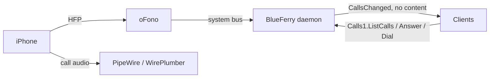

# Phone calls (optional)

BlueFerry can show incoming iPhone calls and answer, decline, place, and hang
up calls through [oFono](https://git.kernel.org/pub/scm/network/ofono/ofono.git)'s
Hands-Free Profile (HFP) support. The feature is **off by default** and is not
needed for messaging. With it off, BlueFerry does not contact oFono at all and
behaves exactly as before.

An earlier HFP experiment was removed from BlueFerry because oFono and
PipeWire's native HFP backend compete for the same Bluetooth profile. This
integration leaves that setup to you, only suggests oFono as an optional
package, and keeps the daemon running normally when oFono is missing.

## What it does



- Finds the iPhone's oFono modem, powers it up while the Bluetooth Classic
  link is connected, and brings it online (iOS does not do this by itself).
- Shows a desktop popup for an incoming call with **Answer** and
  **Decline**. It closes itself when the call stops ringing.
- The Qt client gets a **Phone Calls** dialog, the terminal client a calls
  panel (`c`: answer, hold/resume, hang up, keypad tones, contact
  suggestions), and the CLI a `calls` command group:

  ```bash
  blueferry calls                 # state and current calls
  blueferry calls enable          # or: disable
  blueferry calls dial '+41 79 123 45 67'   # asks first; --yes in scripts
  blueferry calls answer
  blueferry calls dtmf 1234#      # tones on the active call
  blueferry calls hangup          # or: hangup --all
  ```

- Raises oFono's call volume to 100 %, because the 50 % default is barely
  audible with an iPhone.

Audio itself is routed by PipeWire. By default the call uses the system's
speaker and microphone; see [Call speaker and microphone](#call-speaker-and-microphone)
to pick others for calls only.

## How to enable it

1. Install and start oFono (developed with 2.18) as a system service.
   BlueFerry never starts it.
2. Allow your user to talk to oFono. Its shipped policy only admits root and
   `at_console` sessions. Add `/etc/dbus-1/system.d/ofono-local.conf`:

   ```xml
   <!DOCTYPE busconfig PUBLIC "-//freedesktop//DTD D-BUS Bus Configuration 1.0//EN"
    "http://www.freedesktop.org/standards/dbus/1.0/busconfig.dtd">
   <busconfig>
     <policy user="your-login">
       <allow send_destination="org.ofono"/>
     </policy>
   </busconfig>
   ```

   Every process of that user can then fully control oFono, not only
   BlueFerry.
3. Let WirePlumber hand HFP to oFono, for example in
   `~/.config/wireplumber/wireplumber.conf.d/51-bluez-ofono.conf`:

   ```text
   monitor.bluez.properties = {
     bluez5.hfphsp-backend = "ofono"
   }
   ```

   Don't set `bluez5.roles` there; BlueFerry's phone-audio fragment keeps the
   hands-free roles while calls are on.
4. With BlueZ 5.87 or newer, BlueZ's own HFP plugin must be off so it doesn't
   take the channel before oFono. The Arch and Fedora packages already start
   `bluetoothd` with `-P hfp`; elsewhere, add `-P hfp` yourself. If it is
   missing and the hands-free link fails three times in a row, BlueFerry shows
   the state `bluez_conflict` and tries again only every five minutes, or
   when the phone reconnects.
5. Turn on **Enable phone calls through this computer** in the iPhone
   settings of the Qt, GTK or Quickshell client, or run
   `blueferry calls enable`. The choice is saved and
   applies at once. `BLUEFERRY_CALLS_ENABLED=true` in
   `~/.config/blueferry/local.env` still works as the initial value; a saved
   choice wins. The checkbox alone doesn't make calls work: oFono must be
   the hands-free backend (step 3) and BlueZ's own HFP plugin must be
   disabled (step 4). If WirePlumber is not a systemd user service, restart it
   yourself afterwards so it picks up the hands-free roles.

While calls are on and the iPhone is connected, its hands-free link stays
up with this computer: calls ring here and, once answered here, their audio
plays here. Turning calls off (or quitting the backend) releases that link
again, so call audio goes back to the phone.

`blueferry calls` should then show `ready` while the iPhone is connected.

## Call speaker and microphone

BlueFerry can play calls on another speaker and record them from another
microphone than the system's, for example a headset for calls while music
stays on the desk speakers. Other applications and the system defaults
keep their devices.

- **Speaker for calls** and **Microphone for calls** in the client settings
  apply to every call. **Same as system** (the default)
  follows the system's devices.
- During a call, the call view shows the devices actually used and lets you
  switch them for this call only; the next call uses the settings again.
- A chosen device that is not connected is skipped: the call uses the
  system's device and the call view says so. Plugging the device in during
  the call moves the call to it within a few seconds.
- Other Bluetooth headsets can be chosen too; only the iPhone itself is
  left out.
- While a call runs, BlueFerry decides where its audio goes: moving the
  call in a mixer such as pavucontrol or Helvum lasts only until the next
  check. Use the call view's switch instead.

```bash
blueferry calls audio                    # choices, devices and the running call
blueferry calls audio output alsa_output.usb-Logitech_A50-00.stereo-chat
blueferry calls audio input system       # back to the system's microphone
blueferry calls audio output alsa_output.pci-0000_00_1f.3.analog-stereo --this-call
```

Devices are saved by their PipeWire node name, which survives reboots and
replugging. This needs PipeWire with WirePlumber and the `pw-dump` and
`pw-metadata` tools (part of PipeWire). The call audio appears a few seconds
after a call is answered or dialed; until then the call view shows
"Waiting for the call audio".

WirePlumber remembers the last device of the call streams in
`~/.local/state/wireplumber/stream-properties` (a line starting with
`Output/Audio:node.name:bluez_input.<MAC>` or `Input/Audio:…bluez_output.<MAC>`)
and uses it again on the next call. BlueFerry corrects that on every call,
and when calls are switched off it deletes it once more if the call
streams still exist. If calls stay off and a remembered device still
applies, delete those lines while WirePlumber is not running.

## Muting your microphone during a call

**Mute** in the call view of the Qt, GTK and terminal clients (the
terminal's calls panel also takes the `m` key, or
`blueferry calls mute on|off`) mutes this computer's microphone for the
running call only: the caller hears nothing, while other applications keep
recording from the microphone. The mute ends with the call; the next call
starts unmuted. If the call audio drops and comes back during the call (a
new hands-free audio link), it stays muted.

BlueFerry mutes the call's own audio stream in PipeWire with `pw-cli`
(part of PipeWire), not the microphone device. Unmuting that stream by hand
in a mixer lasts for the rest of the call. WirePlumber may remember a mute
for the call stream; BlueFerry lifts it at the start of the next call.

## Phone links

The Qt and GTK clients can open `tel:` and `callto:` links, for example a
phone number on a web page, in a mail, or in a PDF, and place the call
through the iPhone. Clicking such a link always asks first: BlueFerry shows
the number (and the contact's name when a conversation with it is known) and
places the call only after you press **Call**. Without phone calls enabled (see above)
the dialog says so and offers to open the iPhone settings instead. Links that
don't contain a plain number, and emergency numbers, are refused.

BlueFerry registers itself for these links but doesn't make itself the
default. To use it:

- KDE Plasma: System Settings → Default Applications → Phone Numbers, then choose
  BlueFerry.
- GNOME and other desktops: run
  `xdg-mime default io.weirdware.BlueFerry.Gtk.desktop x-scheme-handler/tel`
  (or `io.weirdware.BlueFerry.Qt.desktop` for the Qt client), and the same
  for `x-scheme-handler/callto` if you want those links too.

`xdg-mime query default x-scheme-handler/tel` shows the current choice.
A link can also be passed by hand, for example
`blueferry-qt tel:+41790000000` or `blueferry-gtk --dial '079 000 00 00'`;
an already running window shows the dialog.

Links requiring a phone context (`;phone-context=`), extension (`;ext=`),
ISDN subaddress (`;isub=`), post-dial sequence (`;postd=`), or an unknown
mandatory parameter (`;m-…`) are refused. Dropping these could call a
different destination. Unknown optional parameters may be ignored. Queries
are refused except for the `?call` suffix on `callto:` links.
`*` and `#` are refused as with `dial`.
Printed notation such as `+41 (0)79 …` is also refused: whether the bracketed
zero is dialed depends on the numbering plan. Use an unambiguous international
number instead, such as `+4179…` for Switzerland or `+3906…` for Rome.

## Declining with a message

A ringing call can be declined with a text to the caller, like "Can't talk
now. I'll call you back.": the call is declined on the iPhone first, then
the text goes out through the iPhone's Messages connection (MAP), exactly
like a message written in BlueFerry, and shows up in the conversation.

- The Qt, GTK and terminal clients offer **Decline with message** in the
  call view while a call rings: pick a saved reply or type your own text.
- Only calls with a number get the choice; withheld or unknown callers can
  only be declined.
- If the text cannot be sent (for example while the Messages connection is
  down), BlueFerry says so; the call stays declined.
- Saved replies are edited under **Calls & Audio** in the settings: up to 5
  lines of at most 160 characters each. Until you change them, three English
  replies (translated where a translation exists) are offered; with an empty
  list only your own text remains.

```bash
blueferry calls decline-with-message            # the first saved reply
blueferry calls decline-with-message --reply 2  # another saved reply
blueferry calls decline-with-message --text "In a meeting, call you at 3"
blueferry calls replies                         # list the saved replies
blueferry calls replies set "On my way" "Call you back later"
blueferry calls replies clear                   # own text only
```

The feature exists only while calls are on; it needs no switch of its own.

## Limits

- Experimental. It has worked with one iPhone (iOS 27) on one Gentoo/OpenRC
  desktop: the modem comes up, incoming calls ring, and calls can be answered
  and hung up. Call waiting, hanging up a held call, and DTMF are untested.
- The startup race between oFono and WirePlumber is not solved. If the state
  stays at `searching`, restart oFono after WirePlumber.
- `dial` accepts plain numbers only. `*` and `#` are refused, because they
  would form service codes (for example call forwarding) instead of placing a
  call. Use `dtmf` for keypad symbols during a call.
- Dual-SIM phones expose only the default voice line over HFP.
- Make emergency calls on the iPhone itself, where the call doesn't depend on
  this computer's Bluetooth link or audio. BlueFerry refuses a fixed list of
  known emergency numbers (112, 911, 999, 000, 110, 117, 118, 119, 144 and
  about fifty other national ones), however they are spaced or punctuated.
  The list can't be complete: a number that isn't on it is dialed, and so is
  any longer number that merely contains one, such as `1120` or `0112`.
- Every client asks before it dials. Premium-rate prefixes differ by country,
  so BlueFerry doesn't try to block them.
- Dialing is rate-limited (6 per minute, 60 per hour), answering too (10 per
  minute). Hanging up is never blocked.
- Bluetooth recovery doesn't power-cycle the adapter while a call is in
  progress.

## Privacy

- Caller numbers and names are only returned by the authenticated,
  rate-limited `Calls1.ListCalls` method. The broadcast `CallsChanged` signal
  carries no content.
- Calls are not written to message history.
- The popup hides the caller when `BLUEFERRY_SHOW_NOTIFICATION_CONTENT=false`.
- Logs contain call states and IDs, never numbers or names.
